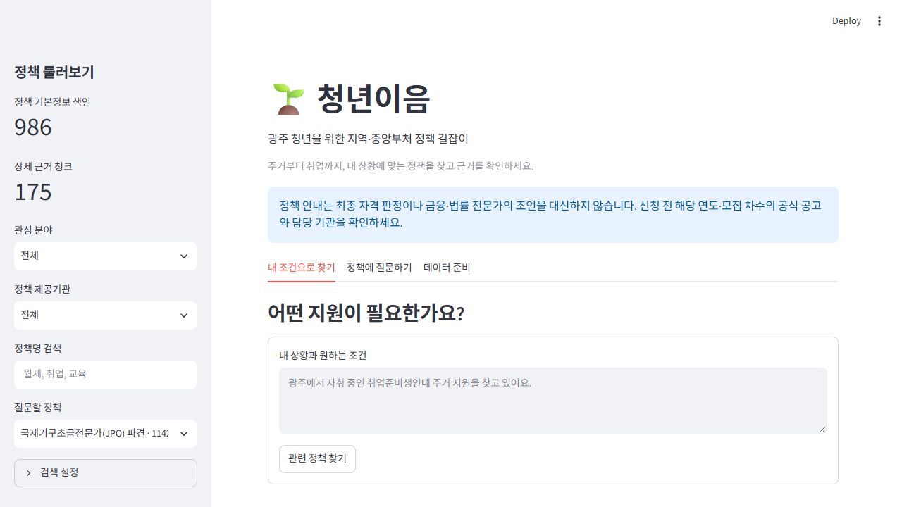

# 🌱 청년이음 · 광주 청년정책 RAG

광주 청년이 지역·중앙부처 정책을 찾고, 자격·서류·신청 준비를 근거와 함께 질문하는 Streamlit 서비스입니다. 정책마다 조건·기간·예외가 달라 공식 자료를 확인해야 하는 문제를 RAG로 다룹니다.



## 제출 산출물

| 산출물 | 파일 |
|---|---|
| 요구사항 정의·필수/심화 표·도메인 근거 | [REQUIREMENTS.md](docs/REQUIREMENTS.md) |
| 컬렉션·청킹·세 프롬프트·Top-k 설계 | [DESIGN.md](docs/DESIGN.md) |
| 요구사항 대조·테스트 결과 | [요구사항·검증 결과](docs/REQUIREMENTS.md) |
| 구현 소스 | `app.py`, `policy_cli.py`, `youth_rag/`, `scripts/`, `tests/` |
| 배포 양식 통합 체크리스트 | [최신 점검 결과·AI 모의 상호 피드백](outputs/20261023_checklist/청년이음_통합체크리스트.xlsx) |
| 실행 화면 증빙 | [화면 증빙 목록](docs/REQUIREMENTS.md#화면-증빙-목록) |

사용자 요청으로 점검 결과와 Codex의 AI 모의 상호 피드백을 한 파일에 통합했습니다. 교육생 간 실제 상호 점검과는 구분합니다. 이전 보고서는 당시 기록이며 최신 결과는 요구사항 정의서의 검증 결과를 기준으로 확인합니다.

## 처음 설치 및 실행 (Git Bash)

Python 3.12 기준입니다. 프로젝트 경로가 다르면 `cd` 경로를 바꿉니다.

```bash
cd /c/streamlit_rag_lab
python -m venv .venv
source .venv/Scripts/activate
python -m pip install -r requirements.txt
python -m streamlit run app.py
```

이미 `.venv`가 있으면 생성 명령은 생략합니다. 실행 Python 경로가 잘못 잡히면 `./.venv/Scripts/python.exe -m streamlit run app.py`로 직접 실행합니다. 브라우저 주소는 `http://localhost:8501`, 종료는 터미널의 `Ctrl+C`입니다.

`.env.example`을 복사해 프로젝트 최상위에 `.env`를 만들고 값을 채웁니다. 기존 `.env`는 덮어쓰지 않습니다.

```dotenv
YOUTH_API_KEY=온통청년_인증키
GMS_KEY=GMS_인증키
TAVILY_API_KEY=Tavily_검색키
```

온통청년 키는 목록 수집·갱신, GMS 키는 임베딩·LLM, Tavily 키는 웹 검색에 사용합니다. 인터넷 연결과 계정의 모델 이용 권한이 필요하며 외부 API 사용량이 발생합니다.

서비스 진입점은 `app.py`입니다.

## 실행 (PowerShell)

```powershell
.\.venv\Scripts\python.exe -m pip install -r requirements.txt
.\.venv\Scripts\python.exe -m streamlit run app.py
```

`.env`의 기존 `API_KEY`(온통청년), `GMS_KEY`를 읽습니다. `YOUTH_API_KEY`도 지원합니다.
GMS 기본 채팅 모델은 `gpt-5.4-nano`, 임베딩은 `text-embedding-3-small`입니다.
다른 OpenAI 호환 공급자는 `OPENAI_API_KEY`, `OPENAI_BASE_URL`로 설정합니다.
키를 화면·JSON·Git에 넣지 마세요. 수집 데이터와 Chroma는 `data/policy_service/`에 저장됩니다.

## 기능 설명과 사용 순서

1. **데이터 준비** 탭에서 정책 수집 (이미 받은 페이지는 재사용, 최신화는 체크박스).
2. 정책 기본정보 색인 (임베딩 API 사용량 발생). 같은 내용은 재임베딩하지 않습니다.
3. 사이드바에서 정책 선택 후 질문. 기본정보는 기존 색인을 재사용하고, 참고 URL 우선 수집 → 검색어로 웹 검색 → LLM 선별 → 본문 수집·색인을 진행합니다.
4. **내 조건으로 찾기**에서 자연어 탐색, 결과의 선택 버튼으로 정책 전환 후 질문 탭 이용.
5. 신청 준비 체크리스트도 같은 RAG 근거를 사용합니다.
6. 선별된 외부 문서의 HTML/PDF 본문을 자동 수집합니다. HWP·스캔 PDF·동적 페이지 자동 추출은 미지원입니다.

CLI도 가능합니다.

```powershell
.\.venv\Scripts\python.exe policy_cli.py collect
.\.venv\Scripts\python.exe policy_cli.py index
.\.venv\Scripts\python.exe policy_cli.py status
.\.venv\Scripts\python.exe -m pytest -q
```

설정은 `policy_config.json`: 청크 1000자/중복 200자, 전체 Top-k 6(항목 1 + 상세 최대 5), similarity/MMR.
청크 설정 변경 후 같은 질문을 하면 캐시된 원문을 다시 분할해 교체합니다. 임베딩 모델별 컬렉션을 분리합니다.
정책 데이터 갱신 후 재색인하세요. 이전 수집 문서 캐시는 자동으로 최신화하지 않습니다.
필요 시 앱을 멈추고 `web_search_cache`, `web_cache`의 해당 파일을 별도 보관 후 제거하고 다시 수집합니다.

## 범위와 품질 한계

- 중앙부처 `0054001` + 광주 거주지역코드 정확 일치. 중앙부처 정책도 추가 지역 제한이 있을 수 있어 자격을 보장하지 않습니다.
- 코드값과 빈 필드는 원본 그대로 보존합니다. 0/공백을 '제한 없음'으로 변환하지 않습니다.
- 광주 코드는 기존 광주 시/자치구 코드와 실제 2026-10-22 응답의 광주권역 5개 자치구 코드(12210/12240/12270/12300/12330)를 포함합니다. 다른 지자체의 전국 거주코드 자료가 섞이지 않도록 등록 최상위기관 6130000/6290000도 함께 확인합니다. 행정구역/원본 코드 개편 시 설정을 대조해 조정해야 합니다.
- 전체 목록을 페이지별로 조회하므로 수집 도중 원본이 바뀌면 스냅샷 일관성은 보장되지 않습니다. 정책번호 중복 제거를 수행합니다.
- 확정 수급 판단, 실시간 잔여 예산·접수 상태 보장은 제공하지 않습니다.
- 관련성 선별과 인용의 의미 정확도는 LLM의 한계가 있습니다. 근거 번호는 유효 범위만 표시하지만 내용의 참/거짓을 자동 보증하지 않습니다.
- 외부 웹/PDF는 robots 규칙·공개 주소를 확인하며 로그인/차단을 우회하지 않습니다. 사이트별 이용·재배포 조건은 전수 확인 전이며 공개 접근 가능 여부만으로 재배포 권한을 주장하지 않습니다.
- 필수 항목은 구현과 검증을 구분하여 `docs/REQUIREMENTS.md`에 기록합니다. F2013 HTML 프론트엔드는 사용자 요청에 따라 선택하지 않습니다.


## 사용 예시와 로컬 저장 구조

- 조건 검색: `광주에서 자취하는 취업준비생인데 주거 지원을 찾고 있어요.`
- 정책 질문: `이 정책의 준비서류와 중복 참여 조건을 알려줘.`
- `신청 준비 질문하기`: 같은 근거 검색 과정을 거쳐 서류·조건·순서를 최대 7개 항목으로 정리합니다.
- 대화는 정책별로 분리하며 새로고침·세션 종료 후 영구 보존하지 않습니다.

| 경로 | 역할 |
|---|---|
| `app.py` | Streamlit UI |
| `policy_cli.py`, `youth_rag/api.py` | 정책 수집·색인 실행 |
| `youth_rag/store.py` | 두 컬렉션·청킹·임베딩·검색 |
| `youth_rag/documents.py`, `web_search.py` | 후보 검색·본문 수집·캐시 |
| `youth_rag/service.py`, `prompts.py` | LangGraph·프롬프트·특화 기능 |
| `policy_config.json` | 모델·청크·검색 설정 |
| `data/policy_service/policies.json` | 수집한 정책 원본 |
| `data/policy_service/chroma/` | 로컬 디스크의 영속 Vector DB |
| `data/policy_service/traces/` | 검색·선별·생성 과정 기록 |

2026-10-23 검증 자료는 986건(중앙부처 657 + 광주 329)입니다. 모든 청년정책을 빠짐없이 제공하는 목록은 아닙니다. 정책 원본·문서 캐시·검색 결과는 수집 시점에 따라 달라집니다.

## 검증과 제출 유의사항

최종 자동 테스트 33개를 통과했고, 의존성 검사도 통과했습니다. 실제 API·임베딩·LLM·웹 수집 실행 및 브라우저 확인을 수행했습니다. 조건 탐색은 모델이 `eligible: true`로 명시한 후보만 표시하며, 현재 신청 여부를 묻지 않았을 때 임의로 해당 조건을 추가하지 않도록 지시합니다. 모든 정책의 답변 정확성을 전수 검증한 결과는 아닙니다.

제출 시 `.env`, `.venv`, 개인 대화·추적 기록을 제외합니다. 권리 확인 전 외부 원문 캐시·PDF·이미지·Vector DB는 공개 배포하지 않고 수집·색인 명령으로 재구축합니다. 작성한 AI 모의 상호 피드백은 실제 교육생 간 점검과 구분합니다.


## RAG2 웹 문서 검색 설정

추출한 검색어는 온통청년 정책명 검색 대신 Tavily 웹 검색에 전달합니다.
[Tavily](https://app.tavily.com/)에서 발급한 키를 `.env`에 추가한 뒤 Streamlit을 재시작하세요.

```dotenv
TAVILY_API_KEY=발급받은_검색키
```

온통청년 키는 정책 데이터 수집·갱신에 사용합니다. 정책에 질문할 때에는 기본정보를 다시 API 호출하거나 RAG 2에 복제하지 않습니다.
검색 결과(제목·요약·URL)를 LLM이 선별하고 HTML/텍스트 PDF 본문을 수집하여 별도 컬렉션에 색인합니다.
후보 중 선택 정책 자체의 공식 문서로 분류한 자료는 모두 수집 대상으로 포함하고, 추가 관련 문서는 별도로 최대 3개 선별합니다. 자체 문서의 수집 실패는 Trace에 기록합니다.
`policy_config.json`의 `web_domains`(검색 출처 범위), `web_max_results`(검색어당 결과 수)를 조정할 수 있습니다.
기본 출처 범위는 go.kr, youthcenter.go.kr, 13account.or.kr입니다.
검색 키가 없거나 문서 수집이 실패하면 화면에 경고하고 RAG 1 정책 기본정보 및 기존 외부 근거로 진행합니다.
자동 수집이 허용되지 않는 페이지, 동적 페이지, 스캔 PDF는 수집되지 않을 수 있습니다.
이전 정책명 검색 캐시는 새 웹 검색 캐시로 재사용하지 않습니다.

## 응답 안정성

- 특정 공고 연도·차수를 질문하면 문서 제목에서 해당 범위가 확인되는 근거가 있는지 검사합니다. 해당 근거가 없거나 답변이 맞지 않는 범위의 출처만 인용하면 확인 불가로 안내합니다. 제목만으로 범위를 확인할 수 없는 문서는 보수적으로 판단하므로, 확인 가능한 원문이 있어도 확인 불가로 안내될 수 있습니다.
- 후보 선별 결과는 `selection_cache`, 최근 수집 실패는 `web_failures`에 저장합니다. 실패 URL은 기본 5분 후 재시도합니다. 검색·본문 캐시와 별개입니다.
- 외부 호출의 간격·일시 오류 재시도는 공통 처리합니다. PDF 추출은 별도 프로세스에서 기본 5초/80페이지 이내로 처리하고, 여러 페이지 청크를 32개씩 묶어 임베딩합니다.
- 답변은 기본 700자, 체크리스트는 1000자 이내로 요청하고 생성 토큰 한도를 설정합니다. 토큰 한도 때문에 잘린 답변은 완성된 안내처럼 표시하지 않습니다.
- 관련 제한과 재시도 횟수는 `policy_config.json`에서 조정합니다. 사이트·모델의 상태에 따라 첫 수집 시간이 달라지며, 모든 질문의 고정 응답 시간을 보장하지 않습니다.

이전 버전의 중복 API 청크는 `scripts/cleanup_api_duplicates.py --apply`로 백업 후 정리할 수 있습니다. 기본 실행은 조회만 하며, 정책 기본정보와 웹/PDF 청크는 삭제하지 않습니다. 정리 전에도 이전 API 청크는 답변 검색 대상에서 제외됩니다.

## 데이터 출처와 이용 조건

### 기본 데이터: 온통청년 청년정책 API

- 제공기관: 한국고용정보원.
- API: https://www.youthcenter.go.kr/go/ythip/getPlcy
- 명세: https://www.youthcenter.go.kr/cmnFooter/openapiIntro/oaiDoc
- [공공데이터 목록과 이용 조건](https://www.data.go.kr/data/15143273/openapi.do): 2026-10-23 무료·이용허락범위 제한 없음 표시 재확인. 호출량/서비스 약관은 발급 계정 조건을 따른다.
- API 키를 출처 링크에 포함하지 않는다. 정책번호의 공개 상세 페이지와 실제 참고/신청 URL을 제공한다.
- 값이 비어 있거나 갱신이 늦을 수 있으므로 원본 수정일과 수집일을 보존한다.
- 사용자 제공 `API코드정보.xlsx`의 코드정보 시트를 `youth_rag/codebook.json`으로 변환해 취업·소득·학력 코드 뜻을 병기한다. 미등록 코드는 추정하지 않는다.

### 추가 근거: 참고 URL·웹검색으로 수집한 공식 문서

- 온통청년 정책의 참고 URL(`refUrlAddr1/2`)과 웹검색으로 찾은 공식 공고·FAQ·안내 웹페이지 및 PDF 본문을 수집한다. 추가 사이트의 API를 연동하는 방식은 아니다.
- API의 이용 조건이 링크된 타 기관 문서까지 자동으로 적용되는 것은 아니다.
- 정책의 참고 URL 및 검색 결과에서 공식 문서를 수집하며, UI에서 원문 출처를 확인할 수 있다. 수집 시 공개 HTTP(S) 주소와 robots 규칙을 확인하고 로그인·차단을 우회하지 않는다.
- 개별 문서의 제목·원문 URL·수집일·관련 정책번호·출처 종류는 메타데이터로 저장하고, 답변에서 실제 인용한 문서의 출처를 사용자에게 제공한다. 수집 사이트는 질문과 검색 결과에 따라 달라지므로 README에 고정 목록으로 나열하지 않는다.
- 공개 접근 가능하거나 robots가 허용한다는 사실만으로 저작물의 재배포 권한이 확보되는 것은 아니다. 프로젝트 제출 시 실제 수집 사이트의 이용 조건을 별도로 확인하고, 원문·이미지의 재배포는 해당 조건을 따른다. 현재 모든 사이트의 개별 이용 조건을 전수 확인한 것은 아니다.

### 외부 호출 운영

- 정책 API는 기존 호출 간격/재시도 로직을 사용한다. Tavily 검색 및 공식 본문 요청은 `youth_rag/http.py`의 호스트별 호출 간격과 제한된 재시도를 사용한다.
- 429·일시적인 5xx 및 연결 시간초과만 재시도한다. 서버가 긴 Retry-After를 요구하면 이를 임의로 줄여 재요청하지 않고 이번 수집을 중단한다.
- 본문 다운로드와 PDF 텍스트 추출에 시간·용량·페이지 수 제한을 적용한다. 제한에 걸린 문서는 실패로 기록하며 읽지 못한 본문을 근거로 표시하지 않는다.
- 위키백과는 현재 수집 경로에 포함하지 않으므로 위키백과 전용 연락처 규칙을 적용했다고 주장하지 않는다. 자동 수집 User-Agent는 YouthPolicyLab/1.0이다.

### 이용 조건과 배포 범위

권리 확인이 끝나지 않은 외부 원문·PDF·이미지 및 이를 포함한 캐시·Vector DB는 공개 배포 대상에서 제외한다. 로컬 학습·검증과 공개 재배포를 구분하며, 공개 서비스로 확장할 때에는 개별 문서의 이용 조건을 확인하거나 제외한다. 출처·정책번호·원문 URL·수집일을 보존하고 로그인·차단을 우회하지 않는다. 이용 조건을 기록했다는 사실이 모든 외부 문서의 재배포 허락을 확보했다는 뜻은 아니다.

## 문서 구성

설명 문서는 README.md, docs/REQUIREMENTS.md(요구사항·검증 결과표·화면 목록), docs/DESIGN.md(RAG 설계서) 세 개다. 소스·통합 체크리스트·화면·실행 로그는 별도 증빙이다. 임시 작업 폴더와 구버전 중복 문서는 실행·제출에 필요하지 않다.
